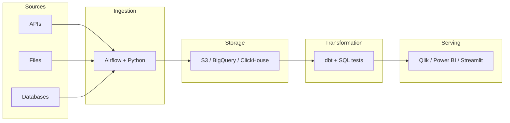

# Vitor Yuske Watanabe

**Analytics Engineer · Data Engineer · Data Analyst** 
Campo Grande, Brazil · [LinkedIn](https://www.linkedin.com/in/vitor-yuske/)

Analytics Engineer and Data Analyst with a Computer Engineering background. I work across ingestion, transformation, orchestration, and BI, mainly with Python, SQL, dbt, Airflow, Qlik, and cloud data platforms. I care about data quality, reproducibility, and making data useful for decisions.

Currently working with analytics engineering, data analysis, and BI at Aderência.

## Stack

| Area | Stack |
|---|---|
| **Languages** |    |
| **Data engineering** |        |
| **Analytics & BI** |      |
| **Data & ML** |        |
| **AI & automation** |      |
| **Platform & engineering** |        |

## How I work

I build data products in layers: land the raw data, transform it into tested models, and ship it to the people who use it. I aim for each layer to have a clear purpose, a test, and a consumer.

<table align="center">
  <thead>
    <tr>
      <th align="center">Principle</th>
      <th align="center">In practice</th>
    </tr>
  </thead>
  <tbody>
    <tr>
      <td align="center">Correctness</td>
      <td align="center">Tests, contracts, reconciliation</td>
    </tr>
    <tr>
      <td align="center">Reproducibility</td>
      <td align="center">Versioned SQL, dbt, containerized jobs</td>
    </tr>
    <tr>
      <td align="center">Usability</td>
      <td align="center">Documented marts, clear metrics, BI handoff</td>
    </tr>
  </tbody>
</table>

## Focus

- Build and maintain batch/ELT pipelines with clear ownership and tests.
- Model analytics data with dbt and document assumptions.
- Turn data into BI products that people actually use.
- Automate manual data work and improve data quality.

## GitHub activity

  <picture>
    <source media="(prefers-color-scheme: dark)" srcset="https://github-profile-summary-cards.vercel.app/api/cards/stats?username=vyuske&theme=github_dark">
    <source media="(prefers-color-scheme: light)" srcset="https://github-profile-summary-cards.vercel.app/api/cards/stats?username=vyuske&theme=github">
    
  </picture>

## Contact

